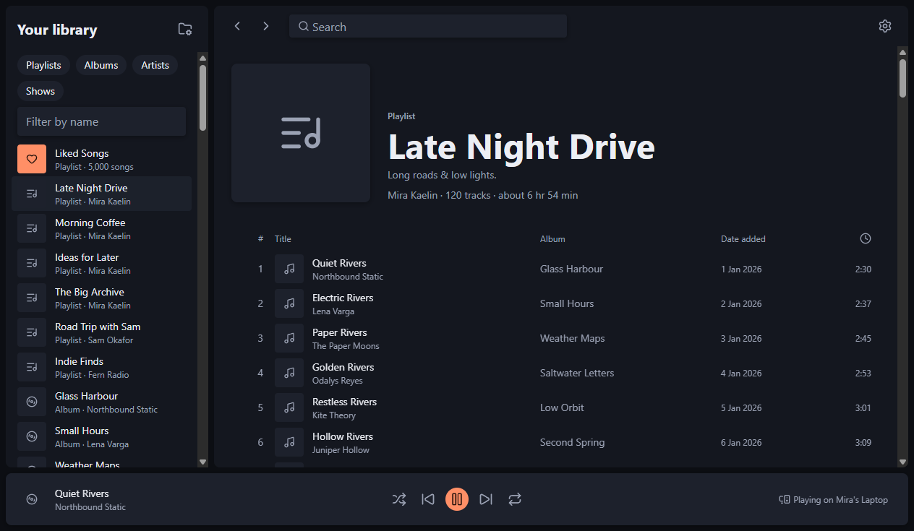
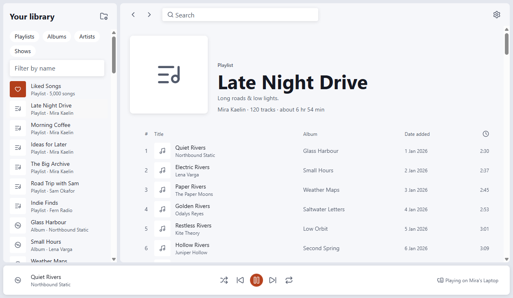

<p align="center"></p>

# Open Spotify

Open Spotify is a desktop client for Spotify on Windows, macOS, and Linux, built for people who
want the app to fit the way they listen. Pick a theme or write your own, down to every color,
font, and corner. Put anything in folders: playlists, artists, albums, and shows, side by side.
It is free and open source, and it controls the Spotify account you already have.



Open Spotify is an unofficial client. It is not affiliated with, endorsed by, or sponsored by
Spotify. Spotify is a trademark of Spotify AB.

> Status: early development. Built in the open by an autonomous team of AI agents; see
> [docs/agents](docs/agents).

## Features

- **Themes:** pick a theme or import your own. Every color, font, and radius is a token; see
  [writing a theme](docs/themes.md).
- **Folders for anything:** group playlists, artists, albums, and shows however you like.
- **A better layout:** resizable panes, keyboard-first navigation, and a denser list view.

The same view in the built-in light theme:



## Requirements

Spotify limits what a third-party client can do, so check these before you install:

- **Spotify Premium.** Spotify lets only Premium accounts control playback from another app.
- **An official Spotify app running somewhere** (desktop, phone, or speaker). Open Spotify plays
  no audio itself: it is a remote control for that app through Spotify Connect; see
  [decision 0002](docs/decisions/0002-playback-through-spotify-connect.md).
- **Your own Spotify Client ID** (free, about five minutes). Spotify allows only five users per
  Client ID, so Open Spotify cannot ship a shared one; see
  [decision 0003](docs/decisions/0003-bring-your-own-client-id.md).
  1. Open the [Spotify developer dashboard](https://developer.spotify.com/dashboard) and create
     an app.
  2. Add the redirect URI `http://127.0.0.1:43821/callback` and select **Web API**.
  3. Under **User Management**, add the email of your Spotify account.
  4. Paste the Client ID into Open Spotify on first launch.

When you are ready, [install Open Spotify](#install).

## Install

Download the installer for your system from the
[latest release](https://github.com/MrPoketes/open-spotify/releases/latest). The builds are not
signed with a paid certificate, so your system warns you the first time you open the app.

- **Windows** (`.exe`): run the installer. If SmartScreen shows "Windows protected your PC",
  click **More info**, then **Run anyway**.
- **macOS** (`.dmg`, Apple Silicon only): open the disk image and drag Open Spotify into
  Applications. The first time you open it, macOS says it could not verify the app. Click
  **Done**, open **System Settings → Privacy & Security**, scroll to the message about Open
  Spotify, click **Open Anyway**, and confirm with your password. You only do this once.
- **Linux**: on Debian or Ubuntu, install the `.deb` with
  `sudo apt install ./open-spotify-<version>-amd64.deb`. On other distributions, make the
  `.AppImage` executable (`chmod +x open-spotify-*.AppImage`) and run it. AppImages need FUSE 2
  (the `libfuse2`, `fuse2`, or `fuse-libs` package, depending on the distribution).

## Development

```sh
pnpm install
pnpm dev      # app with hot reload
pnpm check    # lint, format, typecheck, tests
```

Read [CONTRIBUTING.md](CONTRIBUTING.md) to set up the project and send a pull request,
[AGENTS.md](AGENTS.md) for the coding rules (they apply to humans too), and
[docs/architecture.md](docs/architecture.md) for how the pieces fit.

## License

[MIT](LICENSE)
